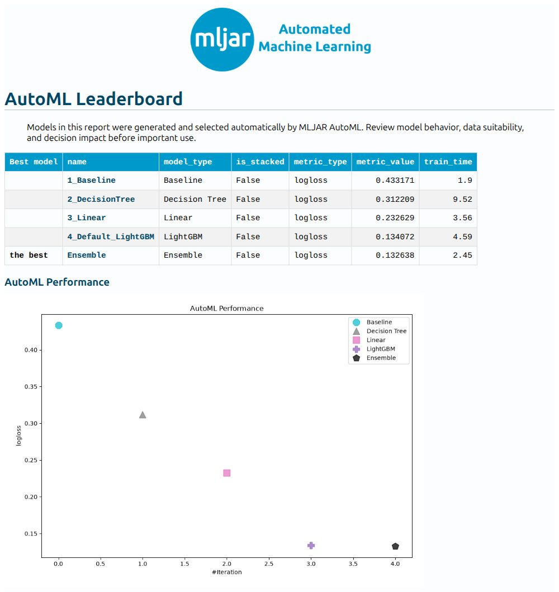
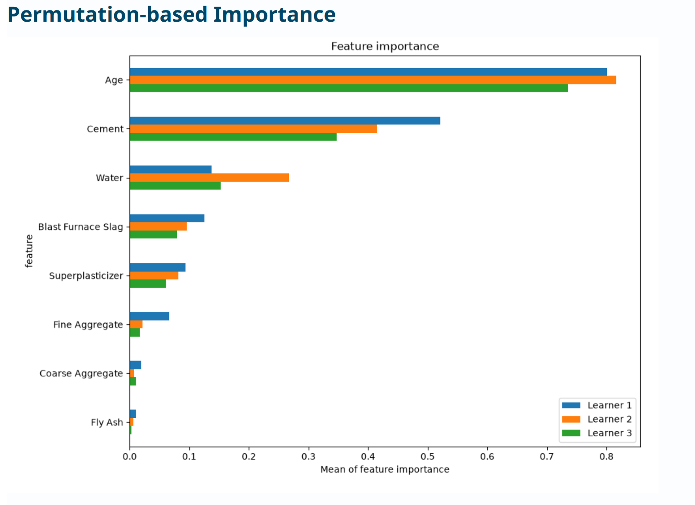
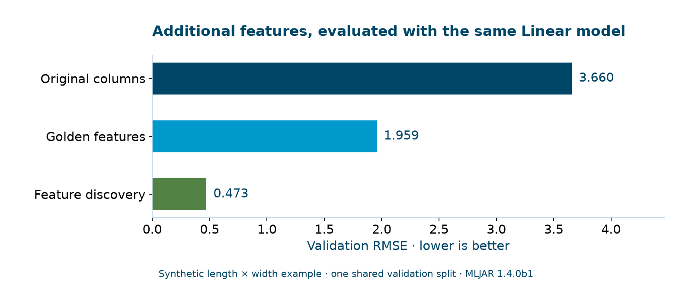
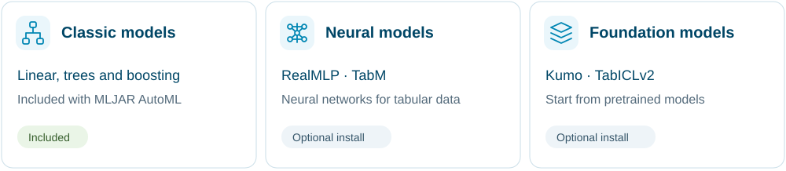
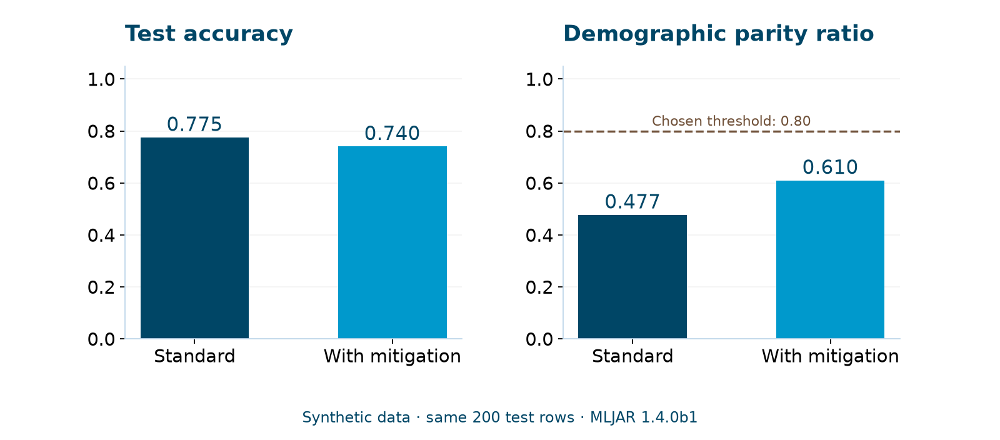
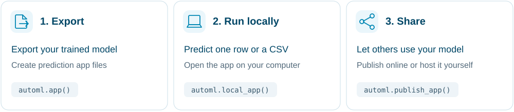
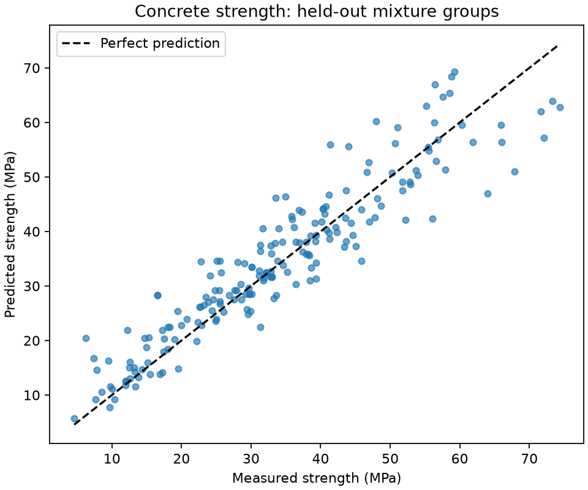
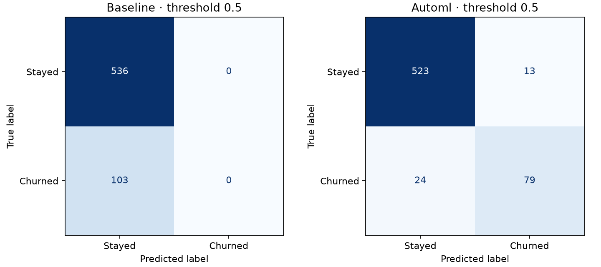

<p align="center">
  <picture>
    <source media="(prefers-color-scheme: dark)" srcset="docs/docs/assets/readme/header-dark.svg" />
    
  </picture>
</p>

<h1 align="center">Machine learning for your tabular data</h1>

<p align="center">
  A Python AutoML package to train models, discover features, and explain predictions.
</p>

<p align="center">
  <a href="#quickstart"></a>
  <a href="https://supervised.mljar.com/examples/"></a>
  <a href="https://mljar.com/studio/"></a>
</p>

<p align="center">
  <a href="https://pypi.org/project/mljar-supervised/1.4.0b1/"></a>
  <a href="https://supervised.mljar.com/install/"></a>
  <a href="https://github.com/mljar/mljar-supervised/actions/workflows/run-tests.yml"></a>
</p>

## One AutoML to rule them all

**New in the 1.4 beta:** RealMLP, TabM mini, Kumo, and TabICLv2 join the classic
algorithms in MLJAR AutoML. Compare three model families through the same Python
interface and see their validation results in one leaderboard.

| Model family | Examples | How to get started |
| --- | --- | --- |
| Classic machine learning | Linear models, Random Forest, XGBoost, LightGBM, CatBoost | Included in the base install |
| New neural architectures | RealMLP, TabM mini | Add the optional `[realmlp]` or `[tabm]` package extras |
| Tabular foundation models (TFMs) | Kumo, TabICLv2 | Add `[tfm]`; pretrained models download on first use |

Start with the published **1.4.0b1 beta** below, or follow the
[CPU and GPU installation guide](https://supervised.mljar.com/install/) to add
the new models. Optional models run in **Compete** mode and depend on your
hardware and available memory.

[See the model comparison example](#compare-classic-neural-and-foundation-models) ·
[Read the release notes](release.md)

## Quickstart

Use Python 3.11 or newer. In a virtual environment, install the beta used below:

```bash
python -m pip install 'mljar-supervised==1.4.0b1'
```

Predict the species of an Iris flower from four measurements. This small dataset
comes with scikit-learn, so you can run the example without downloading data.
We keep 30 flowers out of training to check the predictions.

<!-- README_QUICKSTART_START -->
```python
from sklearn.datasets import load_iris
from sklearn.metrics import accuracy_score
from sklearn.model_selection import train_test_split
from supervised import AutoML

# Predict the flower species from four measurements.
X, y = load_iris(return_X_y=True, as_frame=True)
X_train, X_test, y_train, y_test = train_test_split(
    X, y, test_size=0.2, stratify=y, random_state=42
)

automl = AutoML(
    results_path="AutoML_Iris",
    mode="Explain",
    algorithms=["Baseline", "Decision Tree", "Linear", "LightGBM"],
    total_time_limit=120,
    n_jobs=2,
)
automl.fit(X_train, y_train)

predictions = automl.predict(X_test)
print(f"Test accuracy: {accuracy_score(y_test, predictions):.1%}")
automl.report()  # Creates AutoML_Iris/README.html.
# Save example inputs so the reload example also works in a new Python session.
X_test.head(3).to_csv("iris_new_rows.csv", index=False)
```
<!-- README_QUICKSTART_END -->

Run this in a new working folder, or use the complete [quickstart script](examples/scripts/quickstart.py).
The explicit algorithm list keeps this example on standard CPU models, even if
you have optional model packages installed. The training budget is 120 seconds;
this small example can finish sooner.

In our beta runs on Python 3.11 and 3.12, the selected model predicted **29 of 30
held-out flowers correctly (96.7%)**. This is one small test split, not a general
accuracy claim. [Recorded output and setup](examples/readme/README.md).

<details>
<summary>See the full recorded output</summary>

```text
AutoML directory: AutoML_Iris
The task is multiclass_classification with evaluation metric logloss
AutoML will use algorithms: ['Baseline', 'Decision Tree', 'Linear', 'LightGBM']
AutoML is generating and selecting models automatically. Review outputs before important use.
AutoML will ensemble available models
AutoML steps: ['simple_algorithms', 'default_algorithms', 'ensemble']
* Step simple_algorithms will try to check up to 3 models
1_Baseline logloss 1.098612 trained in 0.29 seconds
2_DecisionTree logloss 0.544928 trained in 3.97 seconds
3_Linear logloss 0.206915 trained in 0.53 seconds
* Step default_algorithms will try to check up to 1 model
4_Default_LightGBM logloss 0.207178 trained in 0.71 seconds
* Step ensemble will try to check up to 1 model
Ensemble logloss 0.111935 trained in 0.78 seconds
AutoML fit time: 12.23 seconds
AutoML best model: Ensemble
Test accuracy: 96.7%
[0 2 1]
```

Training compares models using validation data. The final test accuracy above
uses the separate 30-row test set. The last line shows predictions after reloading
the saved model. Times and results can vary between machines.

</details>

Open **`AutoML_Iris/README.html`** to explore the leaderboard and model reports.
The target labels are `0` (setosa), `1` (versicolor), and `2` (virginica).

### Use the saved model

Training saves your models automatically. In a new Python session:

<!-- README_RELOAD_START -->
```python
import pandas as pd
from supervised import AutoML

saved_model = AutoML(results_path="AutoML_Iris")
new_rows = pd.read_csv("iris_new_rows.csv")
print(saved_model.predict(new_rows))
```
<!-- README_RELOAD_END -->

The quickstart saves three held-out example inputs to `iris_new_rows.csv`.
For your own rows, supply the same input columns. Keep the complete
`AutoML_Iris` directory; shared preprocessing files are needed too.
Use a new results path when starting another training run.

<a id="automated-machine-learning"></a>
<a id="whats-good-in-it"></a>

## Automatic documentation

**See which models were trained and how they performed.** Every successful run
creates a leaderboard and reports for individual models. Follow a model link to
inspect its settings, validation results, and available explanations.

[](https://supervised.mljar.com/assets/customer-churn/report.html)

*An actual customer-churn report from 1.4.0b1.
[Open the full report](https://supervised.mljar.com/assets/customer-churn/report.html).*

Model reports can include feature importance, learning curves, confusion matrices,
and SHAP explanations, depending on the model and `explain_level`.

[](https://supervised.mljar.com/tutorials/concrete-strength/)

*Permutation feature importance from the concrete-strength tutorial. Read the
[model report walkthrough](https://supervised.mljar.com/tutorials/concrete-strength/)
to understand the result.*

Need reports in your own workflow? Read them as Markdown, a dictionary, or JSON:

```python
report = automl.report_structured(format="dict")
```

[Explore automatic reports](https://supervised.mljar.com/features/reports/) ·
[Model explanations](https://supervised.mljar.com/features/explain/)

## Feature engineering

**Try additional features and check whether they help.** AutoML handles missing
values and categorical inputs, can construct numeric combinations with golden
features, and uses feature discovery to propose additional sets of columns.
Feature selection can also test models with fewer inputs.

```python
# Use your training data in X_train and y_train.
feature_search = AutoML(
    results_path="AutoML_Features",
    mode="Compete",
    total_time_limit=3600,
    golden_features=True,
    feature_discovery=True,
)
feature_search.fit(X_train, y_train)
```

Feature discovery is included in the base installation. In a small synthetic
example, it generated `length_mul_width`, `material_te` (target encoding), and
`material_freq`, among other columns. The saved report records their definitions.

[](https://supervised.mljar.com/features/feature_discovery/)

*Measured with 1.4.0b1, the same Linear algorithm, and the same validation split.
The synthetic target includes a length × width interaction, so this illustrates
how generated features can help a linear model. It is not a general benchmark.
[Reproduce this example](examples/readme/README.md).*

Transformations are fitted inside training folds and reused for prediction.
Discovery currently supports shuffled split and K-fold validation; custom,
grouped, and time-ordered validation need a different workflow.

[Golden features](https://supervised.mljar.com/features/golden_features/) ·
[Feature discovery](https://supervised.mljar.com/features/feature_discovery/) ·
[Feature selection](https://supervised.mljar.com/features/features_selection/)

<a id="tabular-foundation-models"></a>

## Compare classic, neural, and foundation models

Use familiar algorithms or add neural and pretrained models. AutoML compares
their validation results.



Install the optional backend using the
[CPU or NVIDIA GPU setup instructions](https://supervised.mljar.com/install/),
then select the models you want to compare:

```python
foundation_search = AutoML(
    results_path="AutoML_FoundationModels",
    mode="Compete",
    algorithms=["LightGBM", "Kumo", "TabICLv2"],
    total_time_limit=3600,
)
foundation_search.fit(X_train, y_train)
```

Model weights download on first use. Hardware, memory, task, and sample-weight
support differ between backends. Standard CPU examples do not need these extras.

[Kumo and TabICLv2](https://supervised.mljar.com/features/sdm/) ·
[RealMLP](https://supervised.mljar.com/features/realmlp/) ·
[TabM](https://supervised.mljar.com/features/tabm/)

## Fairness aware training

**Measure group differences and evaluate bias mitigation.** Supply sensitive
features separately and choose the fairness metric that fits your question.
AutoML reports group metrics and can train reweighted candidates to try to meet
the selected threshold.

```python
# Binary classification; sensitive_train has one row per training example.
# Its columns identify the groups you want to evaluate.
fairness_search = AutoML(
    results_path="AutoML_Fairness",
    algorithms=["Linear", "LightGBM"],
    fairness_metric="demographic_parity_ratio",
    fairness_threshold=0.8,
)
fairness_search.fit(X_train, y_train, sensitive_features=sensitive_train)
```

[](https://supervised.mljar.com/tutorials/fairness-binary-classification/)

*This synthetic example uses two artificial groups. The ratio compares their
positive prediction rates; closer to 1 means more similar rates. Mitigation
improved this ratio but lowered accuracy, and the test ratio remained below 0.8.
It does not establish fairness for a real application.
[Recorded setup and results](examples/readme/README.md).*

[Binary classification tutorial](https://supervised.mljar.com/tutorials/fairness-binary-classification/) ·
[Multiclass](https://supervised.mljar.com/tutorials/fairness-multiclass-classification/) ·
[Regression](https://supervised.mljar.com/tutorials/fairness-regression/)

## Generate web apps for trained models

**Let others make predictions through a web interface.** Export a trained model
as a Mercury app with inputs for one row or a CSV upload for batch predictions.



```python
# Continue from the trained quickstart model.
automl.app(title="Iris species prediction")
```

The base package generates the files. Install the optional runtime to run them:

```bash
python -m pip install 'mljar-supervised[apps]==1.4.0b1'
```

```python
automl.local_app()  # Starts the app locally and opens your browser.
```

When you are ready to publish, use `automl.publish_app()` or host the generated
files yourself. Publishing is a separate action; generating an app does not put
it online.

[Build a prediction app](https://supervised.mljar.com/features/apps/) ·
[Classification tutorial](https://supervised.mljar.com/tutorials/app-classification/) ·
[Regression tutorial](https://supervised.mljar.com/tutorials/app-regression/)

## Customize your workflow

**Choose how models are trained, compared, and evaluated.** Set the budget,
algorithms, validation strategy, and metric for your problem.

### Available modes

| Mode | Starting point for |
| --- | --- |
| `Explain` | Exploring data and inspecting model explanations |
| `Perform` | Training models with a balance of search and prediction cost |
| `Compete` | A broader search with feature engineering, ensembles, and stacking |
| `Optuna` | Hyperparameter search with a separate tuning budget per algorithm |

Modes provide defaults; you can override individual settings. The quickstart
uses `Explain`. See [modes](https://supervised.mljar.com/features/modes/) and
[training stages](https://supervised.mljar.com/features/automl/) for details.

### Keep related rows together

For repeated measurements of the same machine, customer, or subject, use grouped
validation. Pass split indices relative to your training rows:

```python
from sklearn.model_selection import GroupKFold

folds = list(GroupKFold(n_splits=3).split(X_train, y_train, groups=train_groups))
grouped_model = AutoML(
    results_path="AutoML_Grouped",
    validation_strategy={"validation_type": "custom"},
    golden_features=False,
    feature_discovery=False,
)
grouped_model.fit(X_train, y_train, cv=folds)
```

Reserve a separate group-safe test set before this step.
[Run the complete grouped or time-ordered example](https://supervised.mljar.com/features/custom-validation/).

### Use your own metric

Pass a function accepting targets, predictions, and optional sample weights.
AutoML minimizes its result:

```python
import numpy as np

def underprediction_cost(y_true, y_predicted, sample_weight=None):
    error = np.asarray(y_true).ravel() - np.asarray(y_predicted).ravel()
    cost = np.where(error > 0, 2 * error, -error)
    return np.average(cost, weights=sample_weight)

custom_model = AutoML(
    results_path="AutoML_CustomMetric",
    ml_task="regression",
    eval_metric=underprediction_cost,
)
```

This example gives underestimates twice the cost of equal-sized overestimates.
For a score where higher is better, return its negative value.
[Custom metric guide](https://supervised.mljar.com/features/custom-eval-metric/) ·
[Full API reference](https://supervised.mljar.com/api/)

## Examples

Start with a question similar to yours. Each tutorial includes a standalone
script, a notebook, dataset attribution, measured results, and real reports.

| Predict a number from a CSV | Predict which customers may leave |
| --- | --- |
| [](https://supervised.mljar.com/tutorials/concrete-strength/) | [](https://supervised.mljar.com/tutorials/customer-churn/) |
| **Start here · Engineering · Regression** | **Start here · Business · Classification** |
| Estimate concrete strength from ingredients and age. Learn to measure error in MPa and keep related measurements together. | Estimate churn probabilities from service usage. Understand missed customers, false alarms, and a fixed decision threshold. |
| [Read the tutorial](https://supervised.mljar.com/tutorials/concrete-strength/) · [Script](examples/scripts/concrete_strength.py) · [Notebook](examples/notebooks/concrete_strength.ipynb) | [Read the tutorial](https://supervised.mljar.com/tutorials/customer-churn/) · [Script](examples/scripts/customer_churn.py) · [Notebook](examples/notebooks/customer_churn.ipynb) |

Both scripts and notebooks passed on Python 3.11 and 3.12 with published
`mljar-supervised==1.4.0b1`. Their tutorials record the environments, evaluation
protocols, runtime, memory measurements, and reload checks. Results from one
historical split are not promises about another dataset or machine.

[Browse the gallery and advanced guides](https://supervised.mljar.com/examples/).

## Installation

Use Python 3.11 or newer. We recommend Python 3.12.
The install command above uses the same MLJAR version as the tutorials.

| Install option | Additional capabilities |
| --- | --- |
| `mljar-supervised==1.4.0b1` | Standard algorithms, reports, and feature discovery |
| `mljar-supervised[realmlp]==1.4.0b1` or `[tabm]` | Shared RealMLP/TabM backend dependencies |
| `mljar-supervised[tfm]==1.4.0b1` | Kumo/TabICLv2 backend; weights download on first use |
| `mljar-supervised[apps]==1.4.0b1` | Runtime for generated prediction apps |
| `mljar-supervised[all]==1.4.0b1` | All optional model backends |
| `mljar-supervised[all,apps]==1.4.0b1` | Optional model backends and app runtime |

For Torch-based extras, choose a compatible CPU or CUDA PyTorch build first.
See the [installation guide](https://supervised.mljar.com/install/) for exact commands, aliases,
platform limitations, and native-runtime compatibility checks. The base package
does not require Torch or Mercury. Conda-forge releases are maintained separately.

## FAQ

- **How do I save and reload?** Models are saved in `results_path`. Keep the
  complete directory; see [save and load](https://supervised.mljar.com/features/save-and-load-models/).
- **Can I choose classification or regression explicitly?** Set `ml_task`.
  See the [API reference](https://supervised.mljar.com/api/) for supported values.
- **How do I identify probability columns?** Use `predict_all()` to inspect the
  class-labelled prediction columns. Their order matches `predict_proba()`;
  `predict_all()` also includes the predicted label.
- **How is tuning configured?** See [AutoML stages](https://supervised.mljar.com/features/automl/)
  and the [API reference](https://supervised.mljar.com/api/), including `optuna_init_params` for
  reusing Optuna parameters.

## Documentation

[Documentation website](https://supervised.mljar.com/) ·
[Example gallery](https://supervised.mljar.com/examples/) · [API reference](https://supervised.mljar.com/api/) ·
[Get help](https://supervised.mljar.com/get_help/) · [Release notes](release.md) · [Report an issue](https://github.com/mljar/mljar-supervised/issues)

<a id="demo"></a>

For a walkthrough with real outputs, follow the
[concrete-strength tutorial](https://supervised.mljar.com/tutorials/concrete-strength/) or
[customer-churn tutorial](https://supervised.mljar.com/tutorials/customer-churn/).

## Contributing

Read the [contribution guide](https://supervised.mljar.com/contributing/) and
[test instructions](tests/README.md). Thanks to everyone who has
[contributed](https://github.com/mljar/mljar-supervised/graphs/contributors).

## Cite

If you use MLJAR AutoML in your research, please cite:

```bibtex
@inproceedings{plonska2026mljar,
  title     = {{MLJAR AutoML}: Transparent and Fairness-Aware {AutoML} for Tabular Data with Automatic Documentation},
  author    = {P{\l}o{\'n}ska, Aleksandra and P{\l}o{\'n}ski, Piotr},
  booktitle = {Proceedings of the Fifth International Conference on Automated Machine Learning},
  series    = {Proceedings of Machine Learning Research},
  publisher = {PMLR},
  year      = {2026},
  note      = {To appear},
  url       = {https://openreview.net/forum?id=MeGWjXDu0q}
}
```

## License

MLJAR AutoML is available under the [MIT license](LICENSE). Example datasets and
optional model weights have their own licenses, documented with their sources.

Built on the shoulders of giants. Meet the projects and people behind AutoML in
our [Credits](docs/docs/acknowledgments.md).

## Commercial support

For implementation or commercial support, [contact MLJAR](https://mljar.com/contact/).

## MLJAR

Created by [MLJAR](https://mljar.com/). Explore
[MLJAR Studio](https://mljar.com/studio/) for a conversational notebook interface.
