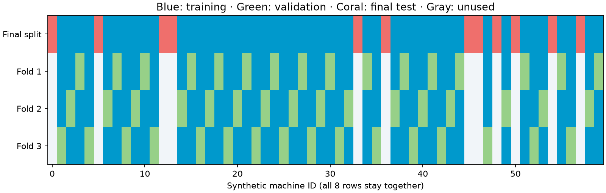
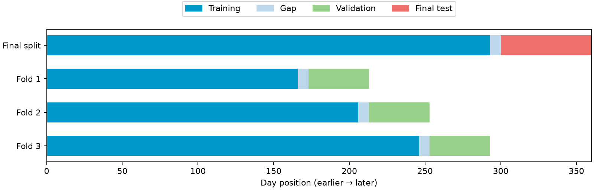

# Choose validation that matches your predictions

A random row split can give a misleading result when rows share a customer,
machine, or experiment—or when the task is to predict a later period. Validation
should reflect what will be new when you use the model.

This guide uses two small **synthetic regression examples** to make the split
rules visible. They are API recipes, not evidence of performance on a real
business or forecasting problem. Each script is standalone and includes training,
a baseline comparison, a split diagram, an HTML report, and a fresh-process
reload check.

## Choose a split

| What will be new? | Split rule | Recipe |
| --- | --- | --- |
| A machine, customer, or experiment absent from training | Keep all rows from each group together | [Grouped validation](#grouped-validation) |
| A later time period | Train on earlier rows; validate on later rows | [Time-ordered validation](#time-ordered-validation) |
| Both a new group and a later period | Enforce both constraints in your own split indices | Neither recipe alone establishes both kinds of separation |

Reserve the **final test set first**. AutoML uses development-data validation
folds to choose models. Evaluate the chosen result on the final test data once;
do not repeatedly tune against that result.

## Run the examples

Use Python 3.11 or 3.12 in a virtual environment:

```bash
python -m pip install 'mljar-supervised==1.4.0b1'
```

[ :material-office-building-outline: Download grouped script](../assets/custom-validation/custom_validation_grouped.py){ .md-button .md-button--primary download="custom_validation_grouped.py" }
[ :material-calendar-clock: Download time-ordered script](../assets/custom-validation/custom_validation_time.py){ .md-button download="custom_validation_time.py" }

Run either downloaded file from its working folder:

```bash
python custom_validation_grouped.py --output AutoML_GroupedValidation
python custom_validation_time.py --output AutoML_TimeValidation
```

Each uses standard CPU algorithms, a 60-second training budget, and two threads.
No dataset download, GPU, or optional Torch packages are required. Choose a new
output directory to repeat a run. These focused recipes do not require a notebook
or documentation generator.

## How the custom-validation API works

Set `validation_strategy={"validation_type": "custom"}` and pass `cv` to
`fit()`. `cv` is a list of `(train_indices, validation_indices)` pairs, with
one pair per fold. The scripts materialize the split iterator with `list()`.

Indices are **zero-based row positions in the exact X and y passed to fit**.
They are not original CSV row numbers, DataFrame index labels, or positions in
the full dataset before holding out a test set. Build the folds after selecting
and ordering development rows. Resetting the index makes this easier to inspect;
it does not fix misaligned X and y.

AutoML fits its model preprocessing within each fold. Any scaling, imputation,
feature selection, or target-dependent encoding you do yourself must also respect
that boundary. Do not fit such transformations on the whole dataset first.

## Grouped validation

Imagine eight measurements from each of 60 machines. We want to predict
measurements for **machines absent from training**. A random row split could
put measurements from the same machine on both sides.

The script creates two numeric inputs and a synthetic response with a
machine-specific effect. `machine_id` is used only for splitting, not as a model
input. It holds out 12 machines (96 rows) for the final test, leaving 48 machines
(384 rows) for development.

With `X`, `y`, and `groups` defined by the script and `SEED = 42`, the split is:

<!-- validation-grouped:start -->
```python
train, test = next(GroupShuffleSplit(n_splits=1, test_size=.2, random_state=SEED).split(X, y, groups))
X_train = X.iloc[train].reset_index(drop=True)
y_train = y.iloc[train].reset_index(drop=True)
train_groups = groups.iloc[train].reset_index(drop=True)
X_test, y_test = X.iloc[test], y.iloc[test]
cv = list(GroupKFold(n_splits=3).split(X_train, y_train, train_groups))
assert set(groups.iloc[train]).isdisjoint(groups.iloc[test])
for fit_rows, valid_rows in cv:
    assert set(fit_rows).isdisjoint(valid_rows)
    assert set(train_groups.iloc[fit_rows]).isdisjoint(train_groups.iloc[valid_rows])
```
<!-- validation-grouped:end -->

Each inner fold uses 32 machines for fitting and 16 for validation. The explicit
checks catch both shared row positions and shared group identifiers.
[GroupKFold](https://scikit-learn.org/stable/modules/generated/sklearn.model_selection.GroupKFold.html)
keeps groups separate between fitting and validation.



The diagram is generated from the actual indices used by the script. The first
row is the outer split; the next three are the model-selection folds. Unused
groups in the inner rows belong to the untouched final test set.

For classification, consider `StratifiedGroupKFold` when class balance matters,
and verify that each fitting and validation partition contains the required
classes. Group size and label distribution can prevent perfect stratification.
The real-data [churn tutorial](../tutorials/customer-churn.md) demonstrates this.

## Time-ordered validation

Imagine a daily process whose response must be predicted in advance. This
synthetic example has 360 evenly spaced daily rows. Its inputs are calendar
position, weekend status, and a planned load assumed known before prediction.
It uses no future measurements or target-derived lag features.

The script sorts by date, holds out the last 60 days, and leaves a seven-day gap
before that test period. Within the first 293 development days, it uses three
expanding training windows, each followed by a seven-row gap and 40 validation days.
Here `data`, `X`, and `y` come from the sorted synthetic data, and `GAP = 7`:

<!-- validation-time:start -->
```python
test_start = len(data) - 60
train = np.arange(test_start - GAP)
test = np.arange(test_start, len(data))
X_train, y_train = X.iloc[train].reset_index(drop=True), y.iloc[train].reset_index(drop=True)
X_test, y_test = X.iloc[test], y.iloc[test]
dates_train = data.date.iloc[train].reset_index(drop=True)
cv = list(TimeSeriesSplit(n_splits=3, test_size=40, gap=GAP).split(X_train))
assert train.max() + GAP < test.min()
assert data.date.iloc[train].max() < data.date.iloc[test].min()
for fit_rows, valid_rows in cv:
    assert set(fit_rows).isdisjoint(valid_rows)
    assert fit_rows.max() + GAP < valid_rows.min()
    assert dates_train.iloc[fit_rows].max() < dates_train.iloc[valid_rows].min()
```
<!-- validation-time:end -->



| Fold | Training row positions | Gap positions | Validation positions |
| --- | --- | --- | --- |
| 1 | 0–165 | 166–172 | 173–212 |
| 2 | 0–205 | 206–212 | 213–252 |
| 3 | 0–245 | 246–252 | 253–292 |
| Final test boundary | Development: 0–292 | 293–299 | Final test: 300–359 |

These positions refer to the sorted synthetic data. Later training windows may
include earlier validation rows: at that later origin, those observations are
assumed available. No fold trains on rows later than its own validation period.

[`TimeSeriesSplit`](https://scikit-learn.org/stable/modules/generated/sklearn.model_selection.TimeSeriesSplit.html)
uses row counts for `gap` and `test_size`. Seven rows mean seven days here because
the samples are daily. With irregular timestamps, repeated timestamps, or several
rows per date, construct date-aware splits instead of assuming that equivalence.

Choose a gap based on the forecast horizon, label availability, and overlapping
target windows. Seven is an illustration, not a recommended universal value.
For multi-step targets, check when every training label becomes available relative
to the validation prediction origin. A gap does not automatically remove leakage
from rolling windows, centered statistics, or future information in features.

The earliest development rows appear only in training, not in validation.
The validation score therefore describes the supplied validation windows, not
every development row. The final test is later than all model-selection windows.

## Fit using your folds

Both scripts use the same configuration:

<!-- validation-fit:start -->
```python
automl = AutoML(
    results_path=str(output / "automl"), mode="Explain",
    algorithms=["Baseline", "Linear", "Decision Tree"],
    ml_task="regression", eval_metric="mae", total_time_limit=60,
    validation_strategy={"validation_type": "custom"},
    feature_discovery=False, golden_features=False, kmeans_features=False,
    features_selection=False, train_ensemble=False, stack_models=False,
    explain_level=1, n_jobs=2, random_state=SEED,
)
automl.fit(X_train, y_train, cv=cv)
```
<!-- validation-fit:end -->

`feature_discovery=False` is explicit because feature discovery does not support
custom validation in this beta. It is still included in the base installation.
Golden features, k-means features, feature selection, stacking, and ensembling are
also disabled here to keep these recipes focused. This is the tested configuration,
not a claim that every disabled option is incompatible with custom validation.

A model has a learner for each supplied fold. At prediction time, MLJAR combines
those fold learners; it does **not** automatically replace them with one learner
refitted on all development rows. In the time example, the latest fold learner
trains only through day 245. The returned model is therefore not equivalent to a
fresh model trained through day 292. Plan and separately validate your final
training strategy when adapting the recipe to deployment.

## Check the results and reload

Each script prints its baseline and AutoML test MAE, then verifies that reload
predictions agree within `rtol=1e-7, atol=1e-7`. It saves:

- `synthetic_data.csv` and `splits.json`: inputs and exact split indices.
- `splits.png`: a diagram of those indices.
- `test_predictions.csv`: actual response, model prediction, and baseline.
- `metrics.json`: scores, package versions, and reload difference.
- `automl/README.html`: the model-selection report.

The median baseline is fitted on development data and evaluated on the same
final test rows. Scores on these synthetic data are implementation checks, not
claims of general predictive quality. Keep the entire `automl` directory to reuse
the model; the HTML report alone cannot make predictions.

Both scripts passed with published MLJAR AutoML 1.4.0b1 on Python 3.11 and 3.12,
including exact fresh-process prediction agreement. See the
[recorded validation evidence](../assets/custom-validation/evidence.json).

## Adapt the scripts to your data

Replace synthetic generation with your data reader. Keep X, y, group identifiers,
and timestamps aligned while filtering and sorting. Choose what counts as a group
or time origin from the question you actually want to answer.

Before fitting, check nonempty partitions, integer positions in range, no overlap
within a split, and the intended group/date constraints. For classification,
check class coverage as well. Record the indices so you can audit the run later.
Use a fresh results path when changing the split; do not resume a directory
created with different data or folds.

Next, [define a custom metric](custom-eval-metric.md),
[read reports](reports.md), or follow the real-data
[concrete-strength example](../tutorials/concrete-strength.md).
