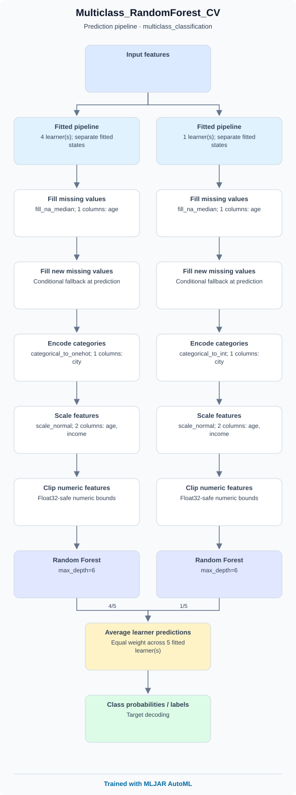

# Explainability in AutoML

There are three modes of explanations available in [`mljar-supervised`](https://github.com/mljar/mljar-supervised). The explanations are controlled by `explain_level` parameter in `AutoML` constructor.

- if `explain_level` is `0` no explanations are produced. Only learning curves are plotted.
- if `explain_level` is `1` the following explanations are produced: learning curves, importance plot (with permutation method), for decision trees produce tree plots, for linear models save coefficients.
- if `explain_level` is `2` the following explanations are produced: the same as `1` plus SHAP explanations and model blueprints.

## Model blueprints

Set `explain_level=2` to include a prediction pipeline diagram in the README of
every successfully saved model, including Baseline, ensembles, and stacked models.

```python
from supervised import AutoML

automl = AutoML(results_path="AutoML_results", explain_level=2)
automl.fit(X, y)
automl.report()
```

Each model directory contains `blueprint.svg`, the diagram, and `blueprint.json`,
its graph representation. The model's `README.md` embeds the SVG, and the main
AutoML README links to all model reports. The HTML report displays the same diagrams.
No additional packages are needed for blueprint generation.

Blueprints use saved fitted preprocessing and learner metadata. They show the
transformation order, learner parameters, prediction averaging, ensemble members
and normalized weights, and stacking dependencies. Matching cross-validation fold
pipelines are grouped, while different transformations remain separate branches.
Each fold retains its own fitted preprocessing and learner. Stacking uses
out-of-fold predictions for training and fitted base-model predictions at inference.

The clickable SVG footer reads **Trained with MLJAR AutoML**. Generation does not
load the training dataset or estimator. Successfully saved models keep their
diagrams if later training is interrupted. If diagram generation fails, AutoML
issues a warning and continues training. Blueprint generation is disabled at
`explain_level=0` and `1`.

This example uses illustrative metadata to show five multiclass cross-validation
learners, with one using a different categorical encoding. Real AutoML blueprints
are generated from the fitted models in your run.



More illustrative diagrams and a regeneration script are available in
[the example gallery](https://github.com/mljar/mljar-supervised/tree/master/examples/blueprints).

## Learning curves

The learning curves show the evaluation metric values in each iteration of the training. The learning curves are plotted for training and validation datasets. The vertical line is used to show the optimal iteration number, which will be later used for computing predictions. Learning curves are always created.


## `Decision Tree` Visualization

The visualization of the `Decision Tree` is created if `explain_level >= 1`. The [`dtreeviz`](https://github.com/parrt/dtreeviz) is used to plot the tree.


## `Linear` model coefficients

For the `explain_level >= 1` the coefficents of the `Linear` model are saved in the Markdown report. The example of cofficents is presented below.

| feature        |   Learner_1 |
|:---------------|------------:|
| capital-gain   |  2.28219    |
| education-num  |  0.843846   |
| age            |  0.468591   |
| sex            |  0.468299   |
| hours-per-week |  0.369091   |
| capital-loss   |  0.279562   |
| race           |  0.104163   |
| education      |  0.0546121  |
| fnlwgt         |  0.0545988  |
| native-country |  0.0173909  |
| occupation     | -0.00958272 |
| workclass      | -0.102386   |
| relationship   | -0.154081   |
| marital-status | -0.358737   |
| intercept      | -1.51172    |

## Features Importance

The features importance is computed with permutation-based method (using scikit-learn [`permutation_importance`](https://scikit-learn.org/stable/modules/generated/sklearn.inspection.permutation_importance.html)). It is available for algorithms other than `Baseline`, subject to the kNN size limit below. The importance is presented in the plot (top-25 importance features) and saved to the file `learner_*_importance.csv` for all features. It needs `explain_level >= 1`.


### Retrieve feature importance in Python

Use `get_feature_importance()` after fitting or loading an `AutoML` model:

```python
# Importance for the best model, or for every saved model.
best_importance = automl.get_feature_importance()
all_importance = automl.get_feature_importance(model="all")

# Select an exact model name from the returned results.
model_name = all_importance["model"].iloc[0]
model_importance = automl.get_feature_importance(model=model_name)
normalized = automl.get_feature_importance(model="all", kind="normalized")
```

The returned pandas DataFrame always has these columns, including when empty:

| Column | Meaning |
| --- | --- |
| `model` | Saved model name. |
| `feature` | Feature name in the learner's preprocessed input. |
| `importance` | Raw permutation importance or its normalized value. |

Rows are sorted by decreasing importance within each model, with feature names
breaking ties. `model="all"` returns separate results for all saved models,
including those that are not loaded for prediction. It does not average different
models into a single ranking. In comparison, `report_structured()` includes a
**global ranking** based on average feature ranks across models.

**Existing importance is reused.** The method reads the learner permutation CSVs
and averages them across folds and repeats, aligning features by name. A feature
absent from a learner is excluded from that feature's fold average. SHAP CSVs are
not included. This retrieval works after reloading or moving the results directory
and does not require training or evaluation data.

**Missing importance is computed when you supply evaluation data.** This also
works when training used `explain_level=0`:

```python
from sklearn.datasets import load_breast_cancer
from sklearn.model_selection import train_test_split
from supervised import AutoML

X, y = load_breast_cancer(return_X_y=True, as_frame=True)
X_train, X_test, y_train, y_test = train_test_split(
    X, y, test_size=0.2, stratify=y, random_state=42
)
automl = AutoML(
    results_path="AutoML_importance", algorithms=["Decision Tree"],
    explain_level=0, train_ensemble=False,
)
automl.fit(X_train, y_train)

importance = automl.get_feature_importance(X=X_test, y=y_test)

# Newly computed learner CSVs are saved, so subsequent calls reuse them.
importance_again = automl.get_feature_importance()
restored = AutoML(results_path="AutoML_importance")
importance_after_reload = restored.get_feature_importance()
```

Provide `X` in the original input format and `y` in the corresponding row order;
the method applies each learner's fitted preprocessing. Prefer held-out evaluation
data. Both arguments must be supplied together. AutoML clears its temporary
training inputs after fitting, so it cannot compute missing importance without
evaluation data. Missing or invalid learner CSVs are computed and saved without
retraining or generating SHAP plots. Existing valid CSVs are kept, even if you
supply different evaluation data. A partially cached model can therefore combine
importance from the original validation folds with importance from the supplied
evaluation data; these values need not match.

If evaluation data is unavailable, or a learner's computation fails, a warning
identifies the model and available learners are still averaged. A model with no
available importance contributes no rows. Invalid arguments and unknown model
names raise errors. Requesting missing importance for many models can take time.
For on-demand kNN computation, evaluation inputs with more than 10,000 rows are
skipped; you can supply a smaller evaluation dataset. Baseline models can return
zero importance when computed on demand, although training does not generate
importance for them.

### Raw values, normalization, and ensembles

`kind="raw"` preserves negative values. The scoring follows the existing training
explanations: an increase in log loss for classification or MSE for regression
when a feature is shuffled. Regression scores use the learner's transformed
target, if target scaling was applied. The scores do not switch to the AutoML
optimization metric. Negative values mean that shuffling improved the score on
the evaluation sample; they are not clipped to zero.

`kind="normalized"` applies `(value - minimum) / (maximum - minimum)` independently
to each model's complete vector after aggregation. A constant vector becomes all
zeros. Values lie between 0 and 1; they are not percentages and do not sum to 1.
Normalization does not make scores from different target transformations or
evaluation datasets directly comparable.

For ensembles, the method returns a **weighted summary of member importances**,
using each member's selection count as its weight. Features absent from a member
contribute zero to this weighted summary. Normalization, if requested, happens
after combining the members. If a member has no available importance, the ensemble
contributes no rows and a warning explains why. This summary is not a direct
permutation measurement of the ensemble's predictions.

Feature names describe the learner's input after preprocessing: categorical
encodings, generated features, and prediction columns used in stacking can appear.
They are not automatically mapped back to the original input columns. For stacked
models, missing importance is computed after generating the required base-model
predictions from the supplied evaluation data.

### kNN interpretation size limit

For `Nearest Neighbors` classification and regression, interpretation is skipped
when either the learner's training fold or validation fold has **more than
10,000 rows**. This avoids expensive repeated predictions for permutation
importance on large datasets. The check uses the full fold sizes, before the
internal kNN fitting subsample; it applies at both `explain_level=1` and `2`.

When both folds have at most 10,000 rows, permutation importance is available
with `explain_level >= 1`. Exactly 10,000 rows remains eligible. kNN SHAP is
unavailable at every dataset size because no kNN explainer is implemented.

A warning reports the training and validation row counts and the
10,000-row limit when interpretation is skipped. With `explain_level=0`, no
interpretation is requested and no size warning is emitted.

Training, predictions, evaluation metrics, and learning curves continue as usual.
Other algorithms' interpretation behavior is unchanged. The threshold is an
internal constant, not a public AutoML parameter.

## SHAP plots

The SHAP explanations are computed if `explain_level = 2`. To compute SHAP explanations the [`shap` package](https://github.com/slundberg/shap) is used.

The SHAP explanations are not available for `Baseline`, `Neural Network`, `CatBoost`, or `Nearest Neighbors`.

### SHAP importance

The SHAP importance example:


### SHAP dependence plots

The SHAP dependence plots example:


### SHAP decision plots

For SHAP decisions plots there are created the top-10 worst and best predictions.

The SHAP decision plots example for the best predictions:


The SHAP decision plots example for the worst predictions:


