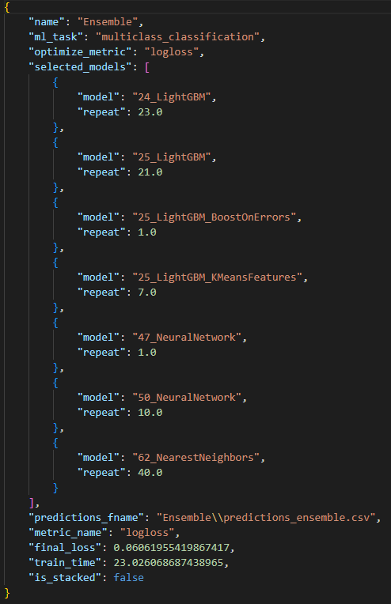
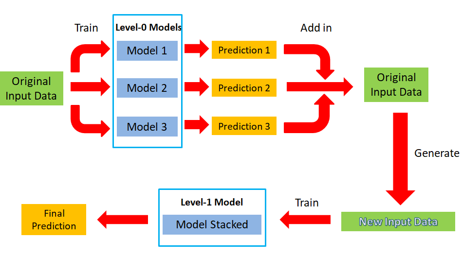
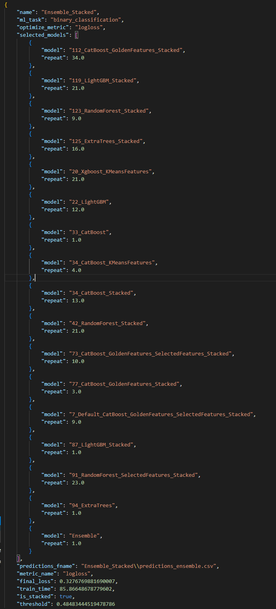

# How does ensemble stacking work?

MLJAR AutoML combines predictions from multiple models using ensemble selection
and stacking. Ensemble selection assigns weights to existing model predictions;
stacking trains additional models using predictions as inputs. Compare the
resulting models in the [AutoML leaderboard and reports](reports.md).

### 1. Ensemble

After all Level-0 models are trained step by step *(like simple_algorithms, default_algorithms, not_so_random, golden_features, insert_random_feature, feature_selection, etc.)*, it will start to process the **Ensemble** step.

In this process, the weight values according to the all Level-0 model will be calculated and become Ensemble model. The final selected Level-0 model and their weight values will list in the ensemble.json under ensemble folder (example file showed as following , The “repeat” here means the weight value of each selected model)

Ensemble selection runs for up to **30 rounds**, using saved validation or
out-of-fold predictions. Each round can select any eligible candidate, including
a previously selected model. Repeated selections increase that model's weight;
they do not add prediction work. The best validation combination is retained,
so the final ensemble can use fewer than 30 distinct members. This fixed internal
limit applies to both ordinary and stacked ensembles and has no public setting.
It does not cap the upstream models required by stacked members.

### 2. Stack

The **Stack** process flow showed as below:

The original input data is used to train several models of Level-0, and the prediction results of the models are added to the original data then generate new input data, which will be used to train the Stacked Model of Level-1 and obtain the final prediction result.

### 3. Ensemble stacking

**Ensemble stacking** means to ensemble the above-mentioned Level-0 and Level-1 models with different weight values and predict final results. The final selected Level-0 and Level-1 models and their weight values will list in the ensemble.json file which under the ensemble_stacked folder. (as shown in the figure below, repeat here means the weight value)

## Selecting stacking inputs

New stacks use at most **five models per algorithm**, ranked by internal validation
loss. This is a fixed internal limit with no public setting; it is not a total
limit across algorithms. Baseline, random-feature probes, existing stacked models
and ensembles are excluded from these inputs. Excluding ensemble inputs prevents
their full member lists from adding hidden prediction dependencies. Fairness constraints still
apply when enabled. All trained models remain in the leaderboard; the final
ensemble can still select ordinary and stacked models.

For new classification training, stacking is disabled if any observed class has
less than 15% of the training rows, even with `stack_models=True`. Exactly 15%
is eligible if the other constraints allow stacking. Counts exclude missing
targets and ignore sample weights. Regression and ordinary ensembles are
unchanged. This heuristic does not guarantee that a model will avoid overfitting.

The selected input names and order are saved with the run. Loading an older run
preserves its original stack, even if it contains more inputs. Reducing an
existing stack requires training new stacked models.

When `max_single_prediction_time` is set, ensemble construction counts shared
prediction dependencies once, including the inputs needed by stacked models.
Repeated selection of a member changes its weight without adding another
prediction cost. Timings are measurements on the training machine, not a
hardware-independent latency guarantee.

## Stacked models in performance plots

The leaderboard includes an `is_stacked` boolean alongside `model_type`.
Performance plots, performance boxplots, and fairness plots show ordinary and
stacked variants as separate groups, for example `CatBoost` and
`CatBoost (stacked)`. This applies to every algorithm and to ensembles, where
`Ensemble (stacked)` can combine ordinary and stacked models.

Stacked variants keep their algorithm color and use a different marker in
scatter plots. Boxplots summarize each group separately. Scores, model selection,
and the underlying `model_type` are unchanged. Older leaderboard tables without
`is_stacked` retain their original grouping.
