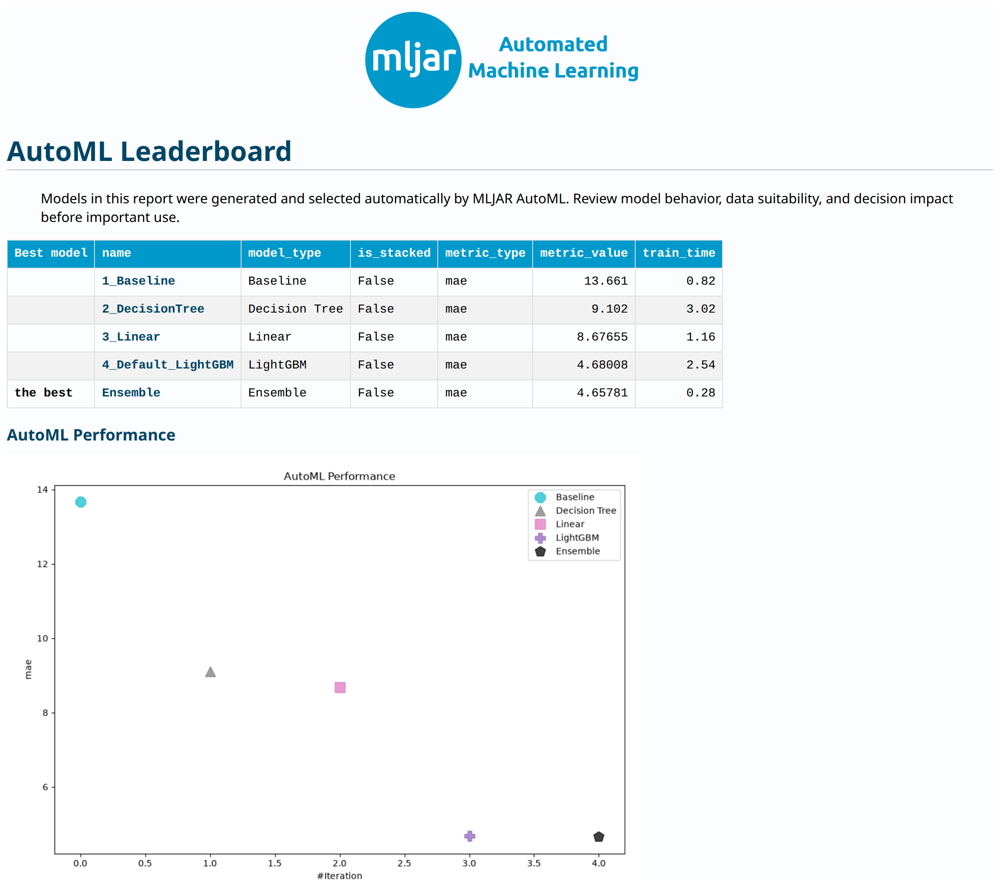
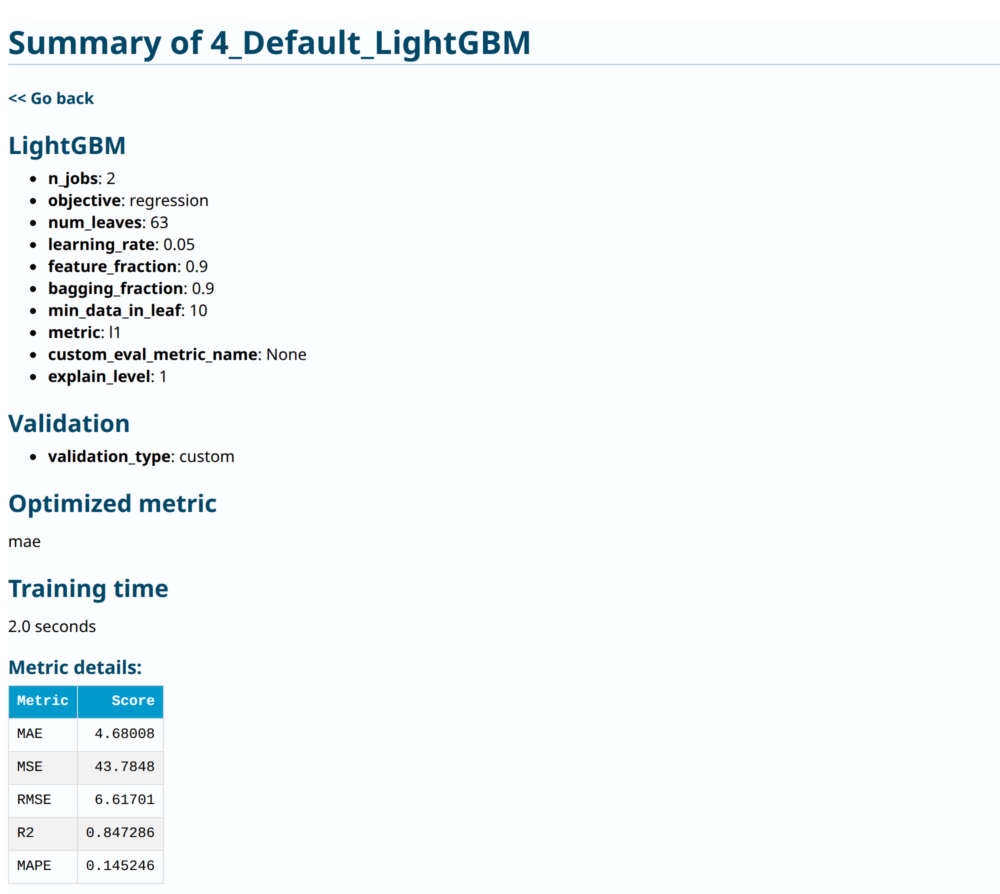

# Predict a number from a CSV with Python

**Your first AutoML regression model: concrete strength**

Imagine you have a spreadsheet of concrete test results. Each row tells you
what went into a mixture, how old the specimen was when it was tested, and its
measured strength. You want to use those past measurements to estimate strength
for another mixture whose ingredients and age you know.

That is the question we will explore: **can we predict concrete strength from
the ingredients and age?** Predicting a number is called *regression*. You do
not need to choose a model yourself: MLJAR AutoML will train several models and
compare them using data reserved within the training set.

We will start by reading the data. Then we will hide some measured strengths
from training, make predictions for those rows, and compare the predictions
with the measurements. Finally, we will read the reports and reuse the saved
model. You will need basic familiarity with running Python; each machine-learning
concept is introduced as we use it.

## First, look at the data

Our [UCI dataset](https://doi.org/10.24432/C5PK67) contains **1,030 measurements**.
Here are the first five rows, showing four of the nine columns:

| Cement (kg/m³) | Water (kg/m³) | Age (days) | Measured strength (MPa) |
| ---: | ---: | ---: | ---: |
| 540.0 | 162.0 | 28 | 79.99 |
| 540.0 | 162.0 | 28 | 61.89 |
| 332.5 | 228.0 | 270 | 40.27 |
| 332.5 | 228.0 | 365 | 41.05 |
| 198.6 | 192.0 | 360 | 44.30 |

Read the first row as: a mixture with 540 kg of cement and 162 kg of water per
cubic metre was tested at 28 days and had a measured strength of 79.99 MPa.
Other ingredients also matter; this short preview omits five ingredient columns.
The first two rows have different coarse aggregate amounts, which are not
shown here.

| What we give the model | What we want it to predict |
| --- | --- |
| Seven ingredient amounts, in kg/m³, plus specimen age in days | Concrete compressive strength, in MPa |

The values we give the model are its **inputs**, also called *features*. The
column we want to predict is the **target**. Here its name in the CSV is
`Concrete compressive strength`. MPa, or megapascals, is the unit used for the
strength measurements.

??? info "See all nine columns in the first five rows"

    | Cement | Blast Furnace Slag | Fly Ash | Water | Superplasticizer | Coarse Aggregate | Fine Aggregate | Age | Concrete compressive strength |
    | ---: | ---: | ---: | ---: | ---: | ---: | ---: | ---: | ---: |
    | 540.0 | 0.0 | 0.0 | 162.0 | 2.5 | 1040.0 | 676.0 | 28 | 79.99 |
    | 540.0 | 0.0 | 0.0 | 162.0 | 2.5 | 1055.0 | 676.0 | 28 | 61.89 |
    | 332.5 | 142.5 | 0.0 | 228.0 | 0.0 | 932.0 | 594.0 | 270 | 40.27 |
    | 332.5 | 142.5 | 0.0 | 228.0 | 0.0 | 932.0 | 594.0 | 365 | 41.05 |
    | 198.6 | 132.4 | 0.0 | 192.0 | 0.0 | 978.4 | 825.5 | 360 | 44.30 |

    The first seven columns are ingredient quantities in kg/m³, age is in days,
    and strength is in MPa. These values are taken directly from the source CSV.

All columns are numeric and this snapshot has no missing values. When predicting,
we supply the eight inputs and leave out the measured strength. The notebook
shows the full table before training, so you can inspect it yourself.

## What you will build

By the end, you will have a saved model, predictions in a CSV, and reports
showing which models AutoML trained. This is the error chart from our recorded run:


*Actual output from the Python 3.12 beta run described below. Each point is a
held-out measurement. The diagonal marks equal predicted and measured strength.*

## Start in Python

[ :fontawesome-brands-python: Download Python script](../assets/concrete-strength/concrete_strength.py){ .md-button .md-button--primary download="concrete_strength.py" }
[ :material-notebook-outline: Download notebook](../assets/concrete-strength/concrete_strength.ipynb){ .md-button download="concrete_strength.ipynb" }

Use Python **3.11 or 3.12** and a terminal in an empty working directory. A virtual
environment keeps this example's packages separate from your other projects:

```bash
python -m venv .venv
```

Activate it with `source .venv/bin/activate` on Linux/macOS, or
`.venv\Scripts\Activate.ps1` in Windows PowerShell. Then install the exact beta:

```bash
python -m pip install 'mljar-supervised==1.4.0b1'
```

Use the explicit version: an unpinned installation may select a different release.
This example needs only the base package. No GPU, optional Torch models, app
server, account, or downloaded model weights are required.

Choose how you want to run:

- **Notebook:** download [concrete_strength.ipynb](../assets/concrete-strength/concrete_strength.ipynb).
  Install Jupyter with `python -m pip install jupyterlab ipywidgets`, start it with
  `python -m jupyterlab`, and open the notebook. Run cells from top to bottom.
  The notebook includes all its Python code and does not require the script.
- **Script:** download [concrete_strength.py](../assets/concrete-strength/concrete_strength.py)
  to your working directory and run:

```bash
python concrete_strength.py --output AutoML_ConcreteStrength
```

The script is standalone: download that one Python file, install the package,
and run it. Open it in your editor to follow the numbered steps in `run()`:

1. Load the measurements and choose inputs and target.
2. Keep related mixtures together when splitting the data.
3. Train a baseline and compare AutoML models.
4. Evaluate held-out rows and predict example inputs.
5. Reload the saved model in a fresh Python process and compare predictions.
6. Plot the errors and save the evaluation record.
7. Create the HTML report and print its location for your browser.

The download helper above `run()` checks the dataset snapshot. The command-line
options at the bottom let you choose a new output path, cached data, or a training
budget; run `python concrete_strength.py --help` to see them.

The script prints training progress and the final evaluation. It downloads a
41.5 kB CSV on first use and checks its checksum. Package installation is a
separate, larger download. The default output directory for the notebook is
`AutoML_ConcreteStrength_Notebook`; substitute that name in the paths below
when following the notebook route.

After the script finishes, open `AutoML_ConcreteStrength/automl/README.html`
in your browser. The script also prints its full location. Documentation
generation and screenshot tools are not needed to run this example.

The training budget is **120 seconds**, with **two CPU threads**. Training may
finish early; imports, reports, prediction, and reload add to total runtime.
Recorded script runs took 16–21 seconds on the Linux server listed under
[Measured results](#measured-results). Laptop and 8 GB validation remain pending.

### Starting in MLJAR Studio

If you use Studio, the intended starting point is this same notebook and its
visible Python code. A suggested prompt is:

> Help me run this concrete-strength notebook. Explain the target and mixture
> groups, compare the held-out error with the baseline, and show the saved model
> report. Use standard CPU models.

This Studio route has not yet been validated for the tutorial. The tested route
here is Python/Jupyter; a Studio walkthrough remains on the release checklist.

## Keep related measurements together

The data includes 427 distinct ingredient combinations. Of these, 181 were
measured at multiple ages. A random row split could give a model measurements
of the same recipe in both training and testing.

We want to assess **mixtures excluded from training**. The example groups rows
by their seven ingredient quantities, excluding age and strength, and reserves
20% of the groups for final testing:

| Purpose | Mixture groups | Rows |
| --- | ---: | ---: |
| Training and model selection | 341 | 838 |
| Held-out test | 86 | 192 |

The 20% setting applies to groups, so the row counts are not an exact 80/20 split.
The fixed seed makes this split repeatable. Its indices are saved in `splits.json`.

Within the training rows, three grouped folds rotate which rows fit a model
and which assess it. AutoML compares these **validation** scores to select
models and ensemble weights. Each mixture stays together in every fold.
The held-out **test** rows are used only after selection to assess the result.

Exact ingredient matches are proxy groups, not verified experiment IDs. They
do not catch every nearly identical recipe, shared experiment, or laboratory.
The dataset has no batch or site identifiers to check those relationships.
Duplicate observations are retained within their groups. This split reduces
recipe overlap; it does not establish independence by laboratory or experiment.

## Train and compare

The example runs AutoML in `Explain` mode with an explicit list: Baseline,
Linear, Decision Tree, and LightGBM. It also evaluates an ensemble that combines
model predictions. `validation_strategy={"validation_type": "custom"}` tells
AutoML to use the grouped folds supplied to `fit(..., cv=cv)`.

The metric is **mean absolute error (MAE)**: the average absolute difference
between measured and predicted strength. Its unit is MPa, and lower is better.
A separately fitted baseline predicts the median training strength for every
test row. The median minimizes constant absolute error. It uses no test labels.

Feature discovery is installed by default but currently does not support
custom grouped validation, so this example sets `feature_discovery=False`.
Golden features, KMeans features, feature selection, and stacking are also
disabled to keep the first workflow focused. See [feature discovery](../features/feature_discovery.md)
and [AutoML stages](../features/automl.md) for later experiments.

### What you will see while training

The terminal prints a line when each model finishes. In a notebook, the same
messages appear below the training cell. Here is an excerpt from our saved run:

<!-- concrete-console:start -->
<figure class="training-console" aria-label="Recorded AutoML training output">
<figcaption class="training-console__header"><span class="training-console__title"><span aria-hidden="true">&gt;_</span> Training output</span><button type="button" class="training-console__copy" data-console-copy hidden aria-label="Copy training output"><svg class="training-console__icon" width="16" height="16" fill="none" stroke="currentColor" stroke-width="1.75" viewBox="0 0 24 24" aria-hidden="true" focusable="false"><rect x="8" y="8" width="12" height="12" rx="2"/><path d="M16 8V5a1 1 0 0 0-1-1H5a1 1 0 0 0-1 1v10a1 1 0 0 0 1 1h3"/></svg><span data-console-copy-label>Copy</span></button></figcaption>
<pre tabindex="0" aria-label="Training log"><code>1_Baseline mae 13.660954 trained in 0.51 seconds
2_DecisionTree mae 9.101997 trained in 2.58 seconds
3_Linear mae 8.676548 trained in 0.71 seconds
<span class="training-console__step">* Step default_algorithms will try to check up to 1 model</span>
4_Default_LightGBM mae 4.680081 trained in 1.99 seconds
<span class="training-console__step">* Step ensemble will try to check up to 1 model</span>
Ensemble mae 4.657805 trained in 0.28 seconds
AutoML fit time: 10.12 seconds
<span class="training-console__result">AutoML best model: Ensemble</span>
</code></pre>
<footer class="training-console__footer"><span>MLJAR 1.4.0b1 · Python 3.12.3</span><a class="training-console__report" href="../../assets/concrete-strength/report.html"><svg class="training-console__icon" width="16" height="16" fill="none" stroke="currentColor" stroke-width="1.75" viewBox="0 0 24 24" aria-hidden="true" focusable="false"><path d="M14 3H6a2 2 0 0 0-2 2v14a2 2 0 0 0 2 2h12a2 2 0 0 0 2-2V9z"/><path d="M14 3v6h6M8 17v-3m4 3v-5m4 5v-2"/></svg><span>Full report</span></a><span class="training-console__status" role="status" aria-live="polite"></span></footer></figure>
<!-- concrete-console:end -->

*These are recorded output lines, so you can select or copy them to compare
with your run. The footer describes this recorded run. Click report screenshots
below to view them at full size.*

Read `4_Default_LightGBM mae 4.680081 trained in 1.99 seconds` as: this model
finished with a validation MAE of about 4.68 MPa. The last line names the selected
model, `Ensemble`. That means AutoML chose a combination of model predictions.

For your run, compare the algorithm names, completed stages, and selected model.
The grouped validation prints three splits before these model lines. Timings
will vary with your machine, and scores can change with package versions or
settings. Different timings alone do not mean your run failed. The final JSON
output contains `automl_mae_mpa`, the separate held-out test score; it is not the
validation score printed on each training line.

## Measured results

The script was run against **published `mljar-supervised==1.4.0b1`** on
26 October 2026, outside the source checkout's import path. Both Python versions
used the same data checksum, seed 42, grouped split, CPU settings, and budget.

| Held-out result | MAE (MPa) |
| --- | ---: |
| Training-median baseline | 12.59 |
| Selected AutoML ensemble | 4.30 |

A 4.30 MPa MAE means an average absolute error of 4.30 MPa on these 192 test
rows. It does not mean every prediction is within 4.30 MPa. The chart shows
some larger errors, including underprediction at the high end. Decide whether
those errors are acceptable for your intended use.

This is a row-weighted score: mixtures with more measurements contribute more.
It is a single split, not an estimate of uncertainty across possible datasets.
Use training validation to explore changes rather than repeatedly optimizing
against this held-out test result.

| Python | Time inside `fit()` | Total script time | Sampled peak combined RSS |
| --- | ---: | ---: | ---: |
| 3.11.15 | 10.79 s | 21.35 s | 1.39 GiB |
| 3.12.3 | 10.12 s | 15.76 s | 1.14 GiB |

Hardware: Intel Core i9-10980XE, Linux x86_64, approximately 251 GiB host RAM.
These are single-run server measurements, not laptop performance promises.
Total time includes startup, reports, plotting, prediction, and reload, with
the dataset already cached. Installation and download are excluded. RSS was
sampled every 0.1 seconds across the script and its reload child; shared memory
can be counted more than once and short peaks can be missed.

Both runs reproduced predictions exactly after reload and printed no warnings.
Package versions, timing records, checksums, and evaluation values are available
in the [measurement record](../assets/concrete-strength/evidence.json).
Your `metrics.json` records the result of your own run, which may differ.

## Read the reports

### Open the overall report

The notebook's report cell displays a clickable report. From a separate Python
session after running the script, generate the same HTML view with:

```python
from supervised import AutoML

model = AutoML(results_path="AutoML_ConcreteStrength/automl")
model.report()
```

Open `AutoML_ConcreteStrength/automl/README.html` in your browser. In Jupyter,
leave `model.report()` as the last expression in the cell to display it there.
You can also open `README.md` in your editor's Markdown preview.

[](../assets/concrete-strength/run-report.png)

*Screenshot of the HTML report generated by beta 1 from the recorded run.
[Explore this saved report](../assets/concrete-strength/report.html) and click
a model name to try its navigation without training first.*

Start with the row marked **the best**. The `metric_value` column is the error
used to compare models; lower is better for MAE. Model names are links to their
individual reports. The chart below the table shows how the candidates compare.
You do not need to understand every setting to find the selected result.

For comparison, the values visible in this screenshot are:

| Model | Validation MAE (MPa) |
| --- | ---: |
| Baseline | 13.66 |
| Decision Tree | 9.10 |
| Linear | 8.68 |
| LightGBM | 4.68 |
| Ensemble, selected | 4.66 |

These are validation scores from the training folds. The ensemble's **4.66 MPa
validation score** and **4.30 MPa test score** use different rows. Also, the
leaderboard's `Baseline` follows AutoML's own implementation; our held-out
reference is the separately fitted training-median baseline.

### Open one model's report

Click **4_Default_LightGBM** in the leaderboard. You will see its settings,
validation information, and evaluation metrics:

[](../assets/concrete-strength/model-report.png)

*Top of the saved LightGBM report. Start with `mae` and the `MAE` row in Metric
details. These describe this individual model's validation error. The other
metrics give alternative views of the errors; they are not extra predictions.*

The parameter list records how the model was trained. You can return to it as
you learn more; you do not need to tune those parameters for this tutorial.
Use **Go back** to return to the overall report. Further down, inspect:

- **Settings and validation:** which configuration was fitted and how it was assessed.
- **Metric details and learning curves:** the recorded errors and training progress.
- **Permutation importance:** how shuffling an input affects predictions on validation data.
- **True versus predicted and residual plots:** where predictions miss measurements.

Importance describes model reliance on inputs; it does not prove causal effects.
Available explanations depend on the algorithm and `explain_level`. The script
uses level 1. Keep the entire model directory, including shared preprocessing
and ensemble dependencies, for future predictions.

[](../assets/concrete-strength/model-importance.png)

*Another part of the same model report. Here age has the largest permutation
importance, followed by cement. Each learner was fitted on a different training
fold. This tells us which inputs this fitted model relied on; it is not a recipe
for changing concrete strength. [Media sources and capture details](../assets/concrete-strength/media-evidence.json).*

## Predict rows and reload

The script writes `new_rows.csv` with three held-out inputs and no target column.
These demonstrate prediction; they are not proposed mixtures or independently
collected new measurements. In a new Python session, load the saved run:

```python
import pandas as pd
from supervised import AutoML

model = AutoML(results_path="AutoML_ConcreteStrength/automl")
new_rows = pd.read_csv("AutoML_ConcreteStrength/new_rows.csv")
predictions_mpa = model.predict(new_rows)
print(predictions_mpa)
```

For your own prediction CSV, provide the same eight input columns and units.
The complete script also loads the model in a separate interpreter and checks
that all held-out predictions agree within `rtol=1e-7, atol=1e-7`. The recorded
runs had zero difference. A failed comparison stops the example.

## Adapt it to your own CSV

1. Replace `load_data(data_path)` with `pd.read_csv("your_data.csv")`. The UCI
   checksum and schema checks are specific to this dataset.
2. Choose `TARGET` and `FEATURES`. Include only inputs available at prediction
   time. This example assumes a numeric regression target.
3. Replace the mixture grouping rule with an appropriate split for your data.
   Repeated customers, subjects, or batches need their own grouping; future
   predictions may need time-ordered validation. Do not blindly reuse `INGREDIENTS`.
4. Choose a training budget, constant baseline, and metric meaningful in your units.
   Reserve test data before training and model selection.
5. Set a new output path. Read the reports, inspect large errors, and verify
   prediction and reload before applying the model to new inputs.

If the output directory already exists, choose a new `--output` name to retrain,
or load the existing model. If the checksum fails, review the downloaded data
against the source rather than removing the check. If the download fails, retry
with a working connection; `--data path/to/concrete.csv` also accepts the same
verified snapshot cached elsewhere.

These observational predictions do not establish the causal effect of changing
a mixture and do not replace physical testing or engineering assessment.

Next, explore [saving and loading models](../features/save-and-load-models.md),
[custom metrics](../features/custom-eval-metric.md), or
[exporting a regression prediction app](app-regression.md).

## Data attribution

Yeh, I. (1998). *Concrete Compressive Strength* [Dataset]. UCI Machine Learning
Repository. [DOI: 10.24432/C5PK67](https://doi.org/10.24432/C5PK67).
Licensed under [CC BY 4.0](https://creativecommons.org/licenses/by/4.0/).
The [source CSV](https://archive.ics.uci.edu/static/public/165/data.csv) was
retrieved on 26 October 2026 without changes; the example adds split assignments
and predictions. Its SHA-256 is
`8d4b15b6fc68cd932d745cbd663d5ceae66dd54422e99c1e4865f2936ab7e2af`.
