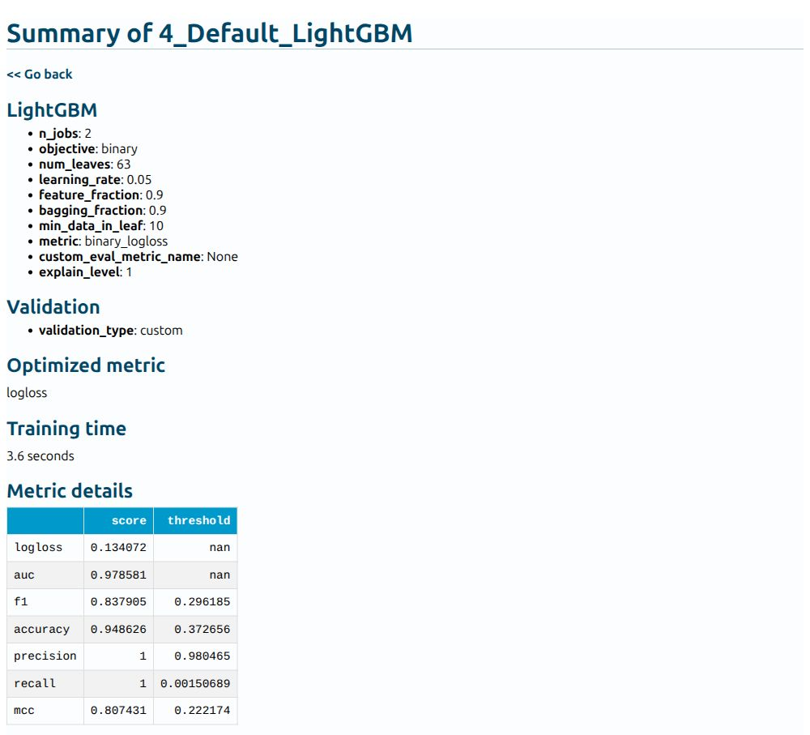

# Predict which customers may leave with Python

**Your first AutoML classification model: customer churn**

Imagine you work for a phone company. You have a spreadsheet of how customers
used the service, and you want to identify customers who might leave. Could
previous usage help you decide which customers deserve a closer look?

We will train a model to estimate **churn**, meaning a customer leaving the
service. Predicting a category is called *classification*. Our two categories
are stayed and churned. We will also predict a probability, then check how often
the model misses customers who leave or flags customers who stay.

You will save a model, read its report, and reuse it for another CSV. The example
teaches prediction; it does not show that contacting someone will prevent churn.

## First, look at the customers

We use [UCI's Iranian Churn dataset](https://doi.org/10.24432/C5JW3Z). It contains
3,150 customer records. These are five real rows, showing a few of the columns:

| Subscription (months) | Call seconds | Text messages | Tariff | Churn |
| ---: | ---: | ---: | --- | ---: |
| 38 | 4370 | 5 | Pay as you go | 0 |
| 39 | 318 | 7 | Pay as you go | 0 |
| 37 | 2453 | 359 | Pay as you go | 0 |
| 38 | 4198 | 1 | Pay as you go | 0 |
| 38 | 2393 | 2 | Pay as you go | 0 |

The first customer had subscribed for 38 months and did not churn. `Churn` is
our **target**: 1 means churned and 0 means stayed. The other selected columns
are **inputs**, also called features. Never include the target among the inputs
when asking the model for a new prediction.

Only **495 of 3,150 rows (15.7%)** have churn equal to 1. Predicting “stayed” for
everyone would therefore look accurate while missing every customer who leaves.
That is why we will look beyond accuracy.

The publisher describes inputs from the first nine months and outcomes at month
twelve. There are no dates or customer IDs in the downloaded file. Our split
checks held-out profiles from this historical sample, not performance on a later
period. See the [dataset review](../assets/customer-churn/dataset-review.md).

## Start in Python

[ :fontawesome-brands-python: Download Python script](../assets/customer-churn/customer_churn.py){ .md-button .md-button--primary download="customer_churn.py" }
[ :material-notebook-outline: Download notebook](../assets/customer-churn/customer_churn.ipynb){ .md-button download="customer_churn.ipynb" }

Use Python **3.11 or 3.12** in an empty working folder:

```bash
python -m venv .venv
```

Activate with `source .venv/bin/activate` on Linux/macOS or
`.venv\Scripts\Activate.ps1` in Windows PowerShell. Then install the exact beta
and run the downloaded script:

```bash
python -m pip install 'mljar-supervised==1.4.0b1'
python customer_churn.py --output AutoML_CustomerChurn
```

No GPU or optional Torch packages are needed. The first run downloads a 132 kB
CSV; package installation is larger. The training budget is **120 seconds** with
**two CPU threads**. It may finish early. Total time also includes imports,
predictions, reload, and report generation.

For the notebook, install `jupyterlab ipywidgets`, run `python -m jupyterlab`, and
open the downloaded notebook. Run its cells in order. It contains the complete
code and uses `AutoML_CustomerChurn_Notebook` as its output directory.

### Follow the script

Read the six numbered sections of `run()` in `customer_churn.py`:

1. Load customers and choose inputs and target.
2. Reserve test profiles and create training-validation folds.
3. Train a baseline and compare AutoML models.
4. Evaluate probabilities and classification errors.
5. Predict example inputs and verify saved-model reload.
6. Create the HTML report and save the evaluation record.

The helpers above `run()` check the data and calculate metrics. The command-line
options below it let you choose another output directory, data path, or budget.
Run `python customer_churn.py --help` for details. No docs-generation tools are
needed to run the script.

## Choose information available before churn

The ten inputs describe call failures, complaints, subscription length, charge
band, call seconds and counts, text messages, distinct called numbers, tariff,
and age. Tariff is converted from numeric codes to meaningful category names.
The charge band is an ordinal code, not a money amount.

We omit account `Status`, which may be too close to the outcome for the intended
prediction point; `Customer Value`, whose formula is not documented; and the
redundant `Age Group`. These are deliberate teaching choices. They do not prove
that the original columns leak future information. Review the actual availability
of every input when adapting the example to your data.

## Keep repeated profiles together

This file contains repeated records. We group identical combinations of the ten
inputs so the same profile cannot occur in both training and testing. We keep
all rows, including profiles with differing outcomes; grouping never uses the
target. Without IDs, we cannot establish whether matching rows are the same person.

The fixed split uses 2,511 rows for training and 639 for testing. Within training,
three grouped folds supply the validation data used to choose models. The script
checks group separation and saves `splits.json`. Grouping and stratification
approximately preserve the churn proportion; they do not create a time split.

## Train and compare

Our baseline gives every row the churn proportion observed in training. It uses
no test labels. AutoML compares Baseline, Linear, Decision Tree, and LightGBM,
and tries an ensemble. It selects by **validation log loss**, which penalizes
confident wrong probabilities. Lower is better.

Feature discovery is included in MLJAR's base installation, but is disabled here
because this example uses custom grouped validation. Other feature engineering
and stacking are disabled to keep this first example focused.

### What you will see while training

<!-- churn-console:start -->
<figure class="training-console" aria-label="Recorded AutoML training output">
<figcaption class="training-console__header"><span class="training-console__title"><span aria-hidden="true">&gt;_</span> Training output</span><button type="button" class="training-console__copy" data-console-copy hidden aria-label="Copy training output"><svg class="training-console__icon" width="16" height="16" fill="none" stroke="currentColor" stroke-width="1.75" viewBox="0 0 24 24" aria-hidden="true" focusable="false"><rect x="8" y="8" width="12" height="12" rx="2"/><path d="M16 8V5a1 1 0 0 0-1-1H5a1 1 0 0 0-1 1v10a1 1 0 0 0 1 1h3"/></svg><span data-console-copy-label>Copy</span></button></figcaption>
<pre tabindex="0" aria-label="Training log"><code>1_Baseline logloss 0.433171 trained in 1.1 seconds
2_DecisionTree logloss 0.312209 trained in 8.63 seconds
3_Linear logloss 0.232629 trained in 2.67 seconds
<span class="training-console__step">* Step default_algorithms will try to check up to 1 model</span>
4_Default_LightGBM logloss 0.134072 trained in 3.6 seconds
<span class="training-console__step">* Step ensemble will try to check up to 1 model</span>
Ensemble logloss 0.132638 trained in 2.45 seconds
AutoML fit time: 25.01 seconds
<span class="training-console__result">AutoML best model: Ensemble</span>
</code></pre>
<footer class="training-console__footer"><span>MLJAR 1.4.0b1 · Python 3.12.3</span><a class="training-console__report" href="../../assets/customer-churn/report.html"><svg class="training-console__icon" width="16" height="16" fill="none" stroke="currentColor" stroke-width="1.75" viewBox="0 0 24 24" aria-hidden="true" focusable="false"><path d="M14 3H6a2 2 0 0 0-2 2v14a2 2 0 0 0 2 2h12a2 2 0 0 0 2-2V9z"/><path d="M14 3v6h6M8 17v-3m4 3v-5m4 5v-2"/></svg><span>Full report</span></a><span class="training-console__status" role="status" aria-live="polite"></span></footer></figure>
<!-- churn-console:end -->

This is saved output from the recorded beta run. Your times and model selection
can differ. The leaderboard's validation scores and the test scores below use
different rows. A different runtime alone does not mean your run failed.

## Understand the predictions

`predict_proba()` returns probabilities for both classes. For this numeric 0/1
target, column 1 represents churn:

```python
probability_of_churn = automl.predict_proba(X_test)[:, 1]
```

A value of 0.7 is the model's estimated churn probability. It is not a guarantee
that exactly 70% of such customers will leave: calibration on representative
future data still needs checking. We turn probabilities into labels using a
**0.5 threshold fixed before evaluation**, rather than tuning against the test set.

- A **false positive** flags a customer who stayed, potentially wasting outreach.
- A **false negative** misses a customer who churned.
- **Precision** asks how many flagged customers actually churned.
- **Recall** asks how many customers who churned were flagged.

A real threshold depends on outreach capacity and error costs. Choose it on
separate validation data, then assess it once on untouched test data. This tutorial
uses its explicit threshold rather than `predict()`, which can use MLJAR's own
selected classification threshold.

## Measured results

<!-- churn-results:start -->
Recorded on 27 October 2026 using **published `mljar-supervised==1.4.0b1`**,
outside the source import path. The table and images use the Python 3.12 run.

| Held-out metric | Baseline | AutoML |
| --- | ---: | ---: |
| Log loss ↓ | 0.4417 | 0.1101 |
| ROC AUC ↑ | 0.5000 | 0.9862 |
| Average precision ↑ | 0.1612 | 0.9440 |
| Brier score ↓ | 0.1352 | 0.0329 |
| Accuracy at 0.5 ↑ | 0.8388 | 0.9421 |
| Precision at 0.5 ↑ | 0.0000 | 0.8587 |
| Recall at 0.5 ↑ | 0.0000 | 0.7670 |

Of 103 customers who churned, the model flagged **79** and missed **24**.
It also flagged **13** customers who stayed. Baseline precision is shown as
zero by convention: the baseline flags nobody at this threshold.

| Python | Time in fit() | Total script time | Sampled peak combined RSS |
| --- | ---: | ---: | ---: |
| 3.11.15 | 28.36 s | 36.31 s | 1.45 GiB |
| 3.12.3 | 25.01 s | 31.39 s | 1.21 GiB |

Both runs reproduced probabilities exactly after reload. See the evidence record
for each run’s scores and package versions. Hardware: Intel Core i9-10980XE, Linux,
approximately 251 GiB host RAM. These are server measurements, not laptop or 8 GB
guarantees. Total time includes startup and reload, using a cached dataset;
installation and download are excluded. Combined process RSS was sampled every
0.1 seconds, can count shared pages more than once, and can miss short peaks.
<!-- churn-results:end -->

ROC AUC measures ranking across thresholds; 0.5 is the constant-score reference.
Average precision summarizes precision and recall across thresholds and is useful
when positives are uncommon. Log loss and Brier score assess probabilities; lower
is better. None of these metrics establishes that a retention campaign will work.


Rows show actual outcomes; columns show predicted outcomes. The baseline flags
no one at 0.5. Read the two off-diagonal cells to see missed churn and false alarms.
These results use one split and count every row, including repeated profiles.
Do not use them as a promise about another company or a future time period.

## Read the reports

Open `AutoML_CustomerChurn/automl/README.html` after the script finishes. The
script prints the full location. In the notebook, the final code cell displays
it directly. You can also [explore the recorded report](../assets/customer-churn/report.html).


Start with the best-model row. Click a model name to open its settings, metrics,
and available explanations. The leaderboard compares validation log loss, not
the held-out results above. An ensemble combines model predictions.



In this screenshot, classification metrics can use **different validation
thresholds**, shown in the last column. Precision 1 and recall 1 are not achieved
together at one threshold. `nan` means a threshold does not apply to that metric.
Our tutorial's test confusion matrix instead uses one fixed threshold of 0.5.

Feature importance describes what a fitted model relies on; it does not prove
that changing a feature would change churn. This tutorial does not evaluate
fairness across customer groups. Keep the full `automl` directory, including
shared preprocessing and ensemble dependencies.

## Predict another CSV and reload

The script saves `new_customers.csv`: three held-out example rows without labels,
not independently collected customers. In a new Python process:

```python
import pandas as pd
from supervised import AutoML

model = AutoML(results_path="AutoML_CustomerChurn/automl")
customers = pd.read_csv("AutoML_CustomerChurn/new_customers.csv")
print(model.predict_proba(customers)[:, 1])
```

Provide the same ten column names and units. Use tariff labels `Pay as you go`
and `Contractual`, as in the saved CSV. The complete script verifies all held-out
probabilities against a fresh-process reload with a small numerical tolerance.

## Adapt it to your own customers

Replace the download helper with your CSV reader, choose a binary target, and
keep only inputs available at the prediction point. Replace profile grouping
with real customer/account groups or a time split when those are available.
Set aside test data before training, compare against a baseline, and review
errors and probability quality. Use a new output path for every training run.

If a checksum check fails, inspect the source rather than deleting the check.
If the output directory exists, choose a new `--output` name or reload the saved
model. The `--data` option accepts a previously downloaded, verified source CSV.

For Studio, an intended starting prompt is: “Help me run this churn notebook,
explain the probabilities and errors, and show the report.” The Studio route and
an unassisted beginner walkthrough remain unvalidated. The Python and notebook
runs have their own recorded evidence below.

Next, explore [custom metrics](../features/custom-eval-metric.md),
[fairness reporting](fairness-binary-classification.md), or
[exporting a prediction app](../features/apps.md).

## Data and run provenance

*Iranian Churn* [Dataset]. (2020). UCI Machine Learning Repository.
[DOI: 10.24432/C5JW3Z](https://doi.org/10.24432/C5JW3Z),
[CC BY 4.0](https://creativecommons.org/licenses/by/4.0/).
Retrieved 27 October 2026. We normalize column spacing, select inputs, and map
tariff codes in memory; the downloaded source file is unchanged.

[Dataset review](../assets/customer-churn/dataset-review.md) ·
[Run evidence](../assets/customer-churn/evidence.json) ·
[Media provenance](../assets/customer-churn/media-evidence.json)
