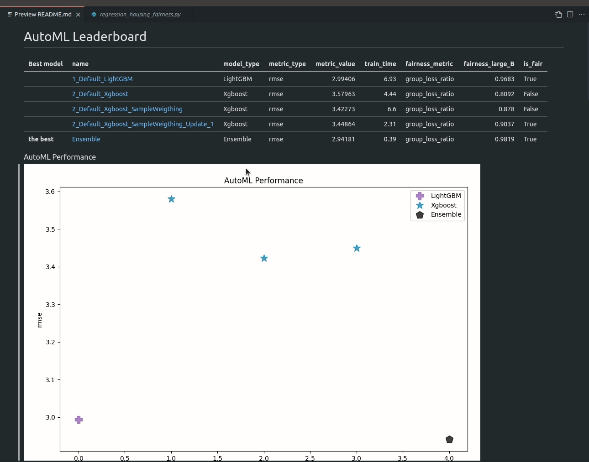

# Fairness aware AutoML on regression task

!!! note "Existing report illustrations"
    The report images on this page are retained from earlier documentation;
    they are not measurements from `1.4.0b1`. Their original execution
    environment is not recorded here. Re-run the example to measure predictive
    performance and group metrics with your data and installed version.


Please run the [example script](https://github.com/mljar/mljar-supervised/blob/master/examples/scripts/regression_housing_fairness.py) to train AutoML on Housing dataset with `large_B` as sensitive feature.

```bash
python examples/scripts/regression_housing_fairness.py
```

Code from example script:

```python
import numpy as np
import pandas as pd
from supervised.automl import AutoML

df = pd.read_csv("./tests/data/boston_housing.csv")
x_cols = [c for c in df.columns if c != "MEDV"]

df["large_B"] = (df["B"] > 380) * 1
df["large_B"] = df["large_B"].astype(str)


print(df["large_B"].dtype.name)
sensitive_features = df["large_B"]

X = df[x_cols]
y = df["MEDV"]

automl = AutoML(
    algorithms=["Xgboost", "LightGBM"],
    train_ensemble=True,
    fairness_threshold=0.9,
)
automl.fit(X, y, sensitive_features=sensitive_features)

df["predictions"] = automl.predict(X)
```

The example report with fairness metrics reported for each model generated automatically by AutoML:


