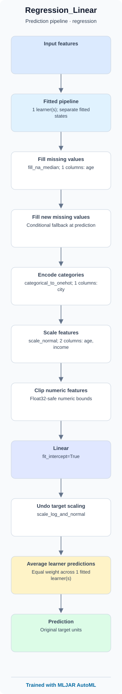
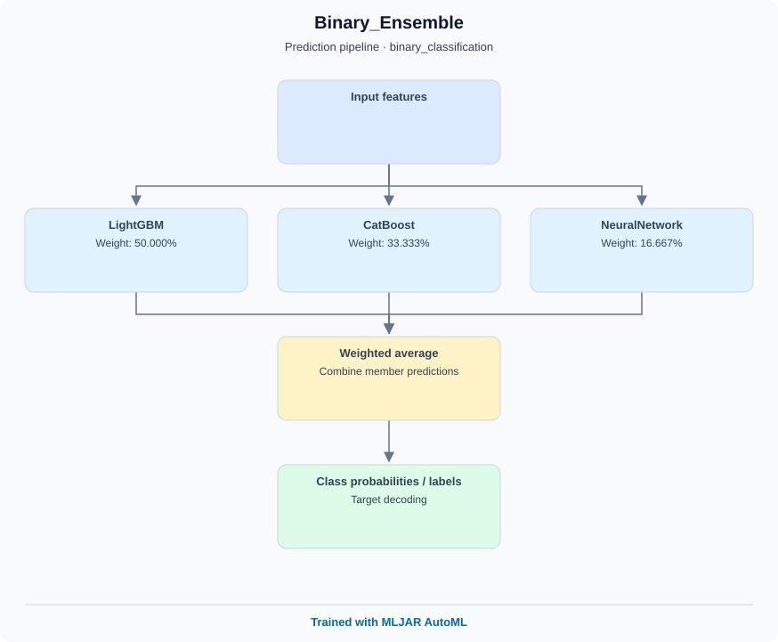
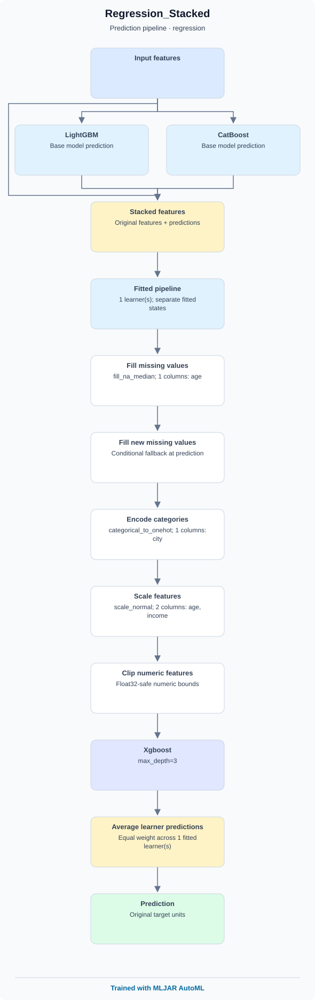
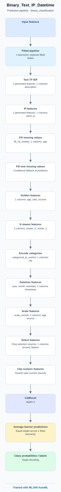
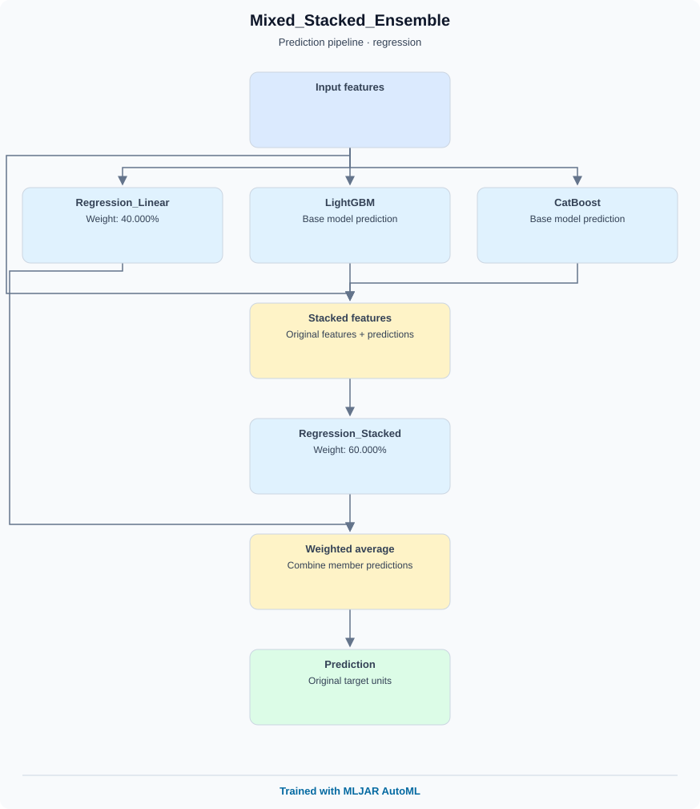

# Model blueprint examples

Set `explain_level=2` to embed fitted model blueprints in AutoML model READMEs.

These six diagrams use illustrative fitted metadata. Integration tests also train real models, including ensembles and stacking.

Every SVG includes a clickable ‘Trained with MLJAR AutoML’ footer in standalone SVGs and inline HTML reports.

Regenerate with `venv/bin/python -m examples.blueprints.generate`.

## Regression

## Multiclass Cv

## Binary Ensemble

## Stacked Regression

## Mixed Features

## Mixed Ensemble

